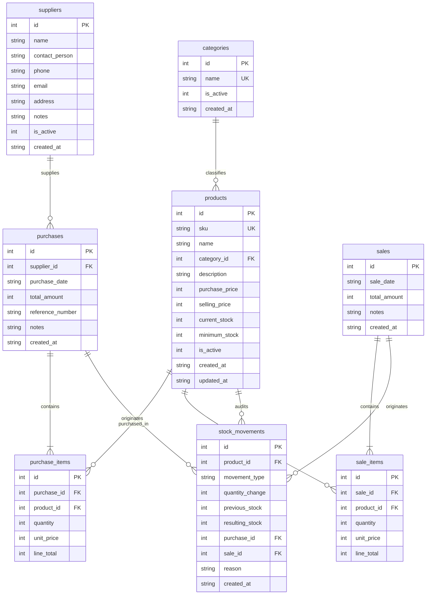

# Comprehensive Project Documentation & Technical Architecture

## Inventory & Stock Management System
**Project Type:** Final-Year B.Tech Computer Science / Information Technology Capstone Project  
**Core Technologies:** Python 3 (Standard Library), SQLite3, CSV Data Interchange, Tkinter & TTK GUI  
**Architecture Pattern:** Layered OOP Architecture (Presentation → Business Logic → Data Access → Database)

---

## 1. Executive Summary & Problem Definition

### 1.1 The Real-World Problem
Small to medium retail and wholesale businesses (stationery shops, electronics dealers, grocery stores, and local distributors) commonly manage inventory manually using paper registers or unvalidated spreadsheets. This practice causes critical operational issues:
1. **Stock Discrepancies:** Manual stock tallying leads to human calculation errors.
2. **Accidental Over-selling:** Staff selling items that are physically out of stock, disappointing customers.
3. **Lack of Replenishment Visibility:** Not knowing which items have reached reorder thresholds until shelves are empty.
4. **Untraceable Shrinkage:** Goods damaged, returned, or lost cannot be reconciled against purchase orders.
5. **Data Loss & Migration Bottlenecks:** Spreadsheets can be easily overwritten or corrupted, and lack relational foreign-key integrity.

### 1.2 The Solution
The **Inventory & Stock Management System** is an offline-first, desktop application engineered in Python 3. It provides complete inventory lifecycle management:
- **Centralized Database:** SQLite with strict foreign key constraints and ACID transactional guarantees.
- **Strict Stock Integrity:** Stock levels can **never** be arbitrarily overwritten in product edit forms. Every quantity change is strictly tied to a Purchase Order (+), Sales Order (-), or an authorized Audit Adjustment (+/-), with 100% audit trail logging.
- **Over-selling Prevention:** Point of Sale engine mathematically rejects sales if requested quantities exceed available on-hand inventory.
- **Zero-Dependency Footprint:** Built exclusively with Python's standard library (`sqlite3`, `csv`, `tkinter`, `decimal`, `datetime`, `unittest`), requiring no external packages or third-party servers.

---

## 2. System Architecture

The application follows a clean **4-Layer Enterprise Architecture**:

```text
┌────────────────────────────────────────────────────────────────────────┐
│                   1. PRESENTATION LAYER (Tkinter / TTK)                │
│  Dashboard | Products | Categories | Suppliers | Purchases | Sales     │
│  Stock Control & Audit | Reports | CSV Interchange | Settings View     │
└───────────────────────────────────┬────────────────────────────────────┘
                                    │ (Calls Services)
┌───────────────────────────────────▼────────────────────────────────────┐
│                  2. BUSINESS LOGIC LAYER (Services)                    │
│  • InventoryService   • ProductService    • SupplierService            │
│  • PurchaseService    • SalesService      • ReportService              │
│  • CSVService         • SampleDataService                              │
│  [Validates rules, enforces atomic transactions, prevents overselling] │
└───────────────────────────────────┬────────────────────────────────────┘
                                    │ (Invokes Repositories)
┌───────────────────────────────────▼────────────────────────────────────┐
│                  3. DATA ACCESS LAYER (Repositories)                   │
│  • ProductRepository  • CategoryRepository • SupplierRepository       │
│  • PurchaseRepository • SaleRepository     • StockMovementRepository   │
│  [Executes parameterized SQL queries; isolates presentation from SQL]  │
└───────────────────────────────────┬────────────────────────────────────┘
                                    │ (Reads / Writes)
┌───────────────────────────────────▼────────────────────────────────────┐
│                    4. STORAGE & INTERCHANGE LAYER                      │
│  • SQLite3 Database (inventory.db with PRAGMA foreign_keys = ON)       │
│  • CSV Files (Exports and validated imports via Python csv module)     │
└────────────────────────────────────────────────────────────────────────┘
```

---

## 3. Deep Dive: Three Core Academic Python Concepts

This project was built to demonstrate proficiency in the exact three core Python concepts designated for final-year practical examination:

### Concept 1: Object-Oriented Programming (OOP)
OOP is implemented across all components:
1. **Encapsulation & Domain Models (`models/`):**
   - Each real-world entity is represented as an encapsulated class: `Product`, `Category`, `Supplier`, `Purchase`, `PurchaseItem`, `Sale`, `SaleItem`, and `StockMovement`.
   - **Properties:** The `Product` model encapsulates stock classification methods:
     ```python
     @property
     def is_low_stock(self) -> bool:
         return self.current_stock > 0 and self.current_stock <= self.minimum_stock

     @property
     def is_out_of_stock(self) -> bool:
         return self.current_stock <= 0

     @property
     def stock_status(self) -> str:
         if self.current_stock <= 0:
             return "Out of Stock"
         elif self.current_stock <= self.minimum_stock:
             return "Low Stock"
         return "In Stock"
     ```
2. **Separation of Concerns:**
   - **Data Representation:** Handled by Dataclass models (`models/`).
   - **Persistence:** Handled by Repositories (`repositories/`).
   - **Business Rules:** Handled by Services (`services/`).
   - **User Interface:** Handled by TTK Frame components (`ui/`).

### Concept 2: SQLite Relational Database & Data Integrity
1. **Foreign Key Integrity:** SQLite disables foreign keys by default. Our connection factory (`database/connection.py`) explicitly executes:
   ```python
   conn.execute("PRAGMA foreign_keys = ON;")
   ```
2. **Financial Precision via Integer Paise:** Floating-point numbers produce rounding artifacts (e.g., `0.1 + 0.2 = 0.30000000000000004`). All monetary values (purchase prices, selling prices, line totals, and grand totals) are stored as **integer paise** (₹1.00 = 100 paise) using Python's `Decimal` class for conversion.
3. **ACID Transactions (`BEGIN`, `COMMIT`, `ROLLBACK`):**
   - When a sale is processed, the system must:
     1. Insert the `sales` header record.
     2. Insert each item into `sale_items`.
     3. Decrement `current_stock` in `products`.
     4. Insert an audit movement into `stock_movements`.
   - If any step fails (e.g. stock shortfall or constraint violation), a `conn.rollback()` is executed, ensuring zero partial or corrupted updates.

### Concept 3: CSV Data Interchange
- Python's standard `csv` library is utilized with `csv.reader`, `csv.writer`, `csv.DictReader`, and `csv.DictWriter`.
- **Validation Pipeline:**
  1. Checks for empty files and invalid encodings (`utf-8` / `utf-8-sig`).
  2. Normalizes column headers (case-insensitive and whitespace-stripped).
  3. Verifies required fields (`SKU`, `Product Name`, `Category`, `Purchase Price`, `Selling Price`).
  4. Identifies duplicate SKUs within the file and active database.
  5. Auto-creates missing categories on the fly.
  6. Generates detailed import logs detailing imported rows, skipped rows, and reasons for rejection.
- **Export Capabilities:** Exports Products, Sales ledgers, Purchase orders, and Stock audit trails to formatted CSV files.

---

## 4. Relational Database Schema

The database consists of 8 normalized relational tables:



---

## 5. Detailed Module Breakdown

### 5.1 Dashboard (`ui/dashboard.py`)
- Real-time operational command center.
- **Summary KPI Cards:** Total active products, units in warehouse, low-stock items count, out-of-stock items count, today's sales revenue, today's purchase spend, cumulative sales, and total inventory cost valuation.
- **Live Alert Feed:** Immediate view of low-stock and depleted products.
- **Recent Movement Stream:** Chronological feed of latest warehouse stock changes.

### 5.2 Product Management (`ui/products.py`)
- Full catalog table with sortable columns, SKU search, category dropdown filtering, and stock status filters.
- **Add Product Dialog:** Enforces unique SKU, non-negative prices, valid category selection, and optional opening stock.
- **Edit Product Dialog:** Updates product name, pricing, description, and reorder levels while **strictly protecting current stock**.
- **Soft Deactivation:** Deactivating a product retains all past sales and purchase history while hiding it from active POS sales.

### 5.3 Category Management (`ui/categories.py`)
- Organize products into logical departments.
- Inline category creation and renaming.
- **Safety Rule:** Prevents deactivation of categories that currently have active products linked.

### 5.4 Supplier Management (`ui/suppliers.py`)
- Comprehensive vendor directory storing contact person, phone, email, address, and delivery terms.
- Regex validation for vendor email addresses.

### 5.5 Purchase Management / Stock-In (`ui/purchases.py`)
- Multi-item Purchase Order cart interface.
- Calculates unit cost, quantity, line totals, and grand total in real time.
- Atomic execution: Upon saving, vendor order is recorded, product `current_stock` is increased, and stock movement logs are generated.
- Purchase history tab with itemized order viewer dialog.

### 5.6 Sales Management / Stock-Out (`ui/sales.py`)
- Fast Point of Sale (POS) checkout interface.
- **Live Stock Checker:** Displays current available quantity when selecting products.
- **Over-selling Rejection:** Immediately prevents adding items to cart if requested quantity exceeds current stock.
- Reduces inventory upon confirmation, records sales receipt, and logs stock movements.

### 5.7 Stock Control & Movement History (`ui/stock.py`)
- Warehouse balance overview with color-coded badges:
  - 🟢 **In Stock:** Inventory above threshold.
  - 🟡 **Low Stock:** Inventory at or below reorder threshold.
  - 🔴 **Out of Stock:** Zero inventory remaining.
- **Stock Adjustment Modal:** Allows authorized positive or negative stock corrections with **mandatory audit reason**.
- **Movement History:** Full chronological log showing date, SKU, product, movement type, change (+/-), previous balance, resulting balance, and transaction reference.

### 5.8 Business Reports (`ui/reports.py`)
- Interactive reporting with date range filtering:
  1. **Inventory Valuation Report:** Breakdown of cost value vs. retail value.
  2. **Low-Stock Replenishment Report:** Highlights items requiring restock with suggested reorder quantities.
  3. **Sales Performance Report:** Revenue, items sold, and transaction dates.
  4. **Procurement Report:** Vendor purchases and expenditures.
- One-click CSV export button for every report.

### 5.9 CSV Data Interchange (`ui/csv_view.py`)
- **Import:** File browser, table preview of the first 12 rows, header mapping, validation engine, and import results dialog.
- **Export:** Instant one-click exports for Products, Sales, Purchases, and Stock Movements.
- **Template Generator:** Creates `exports/products_import_template.csv` for immediate customer testing.

### 5.10 Settings & Demonstration Utilities (`ui/settings_view.py`)
- Live database diagnostics: file location, file size, table row counts.
- **✨ Load Sample Demonstration Data:** Seeds realistic categories, suppliers, inventory items with varied stock levels, purchase orders, and sales receipts for live viva examinations.
- **🗑️ Reset Database:** Clears all records with confirmation.

---

## 6. Viva Examination Q&A Guide

### Q1: Why did you choose SQLite over MySQL or PostgreSQL for this project?
> **Answer:** SQLite is an embedded, serverless, zero-configuration database that is built directly into Python's standard library. For a single-location small business or desktop application, it avoids the overhead of managing a database server, network credentials, or port configurations. Furthermore, SQLite fully supports ACID transactions and foreign-key constraints (`PRAGMA foreign_keys = ON;`), providing enterprise-grade reliability in a self-contained local file.

### Q2: How did you handle monetary rounding errors?
> **Answer:** Standard IEEE 754 floating-point arithmetic introduces rounding artifacts (e.g., `0.1 + 0.2 = 0.30000000000000004`). In this project, all monetary values are stored in the database as **integer paise** (₹1.00 = 100 paise). We use Python's `Decimal` module with `ROUND_HALF_UP` during input conversion. When presenting values to users, we divide integer paise by 100.0, completely eliminating calculation discrepancies.

### Q3: How does your system guarantee stock calculation integrity?
> **Answer:** We enforce two key architectural rules:
> 1. Current stock is **never** directly editable via the standard product edit form.
> 2. Stock changes occur exclusively via atomic database transactions: Purchases increment stock, Sales decrement stock, and manual adjustments require an authorized reason. Every change writes an immutable audit record to `stock_movements`.

### Q4: What happens if a sale requests more units than are in stock?
> **Answer:** The `SalesService.record_sale` method executes a row check against `current_stock`. If `requested_quantity > current_stock`, the transaction raises a `ValueError("Insufficient stock...")`, halting checkout before any database writes occur.

### Q5: How do you handle CSV files with duplicate SKUs or missing columns?
> **Answer:** In `CSVService.import_products`, we normalize headers and verify that required columns exist. For rows, we track seen SKUs in a set and check existing active products in SQLite. Invalid or duplicate rows are caught, documented in an error list, and skipped without crashing the process, allowing all valid rows to be imported successfully.
